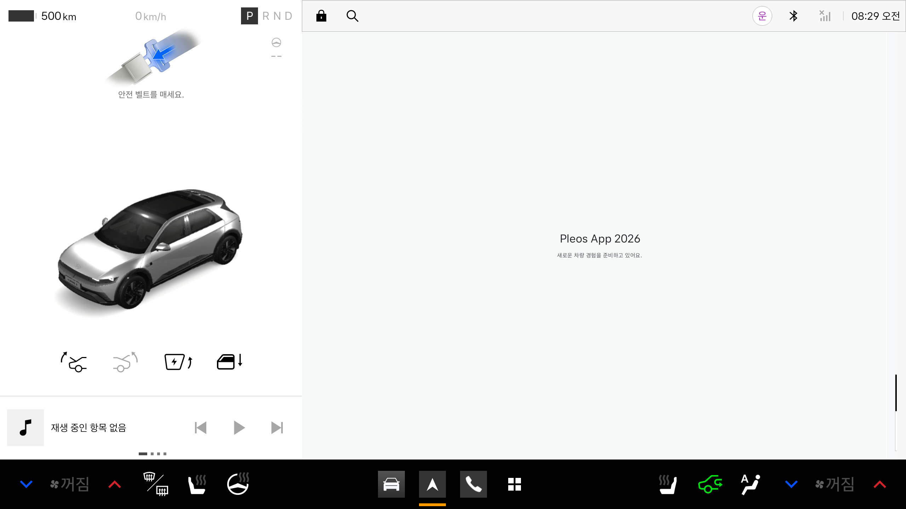
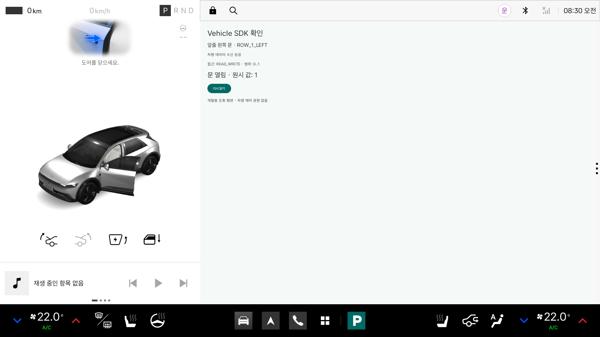
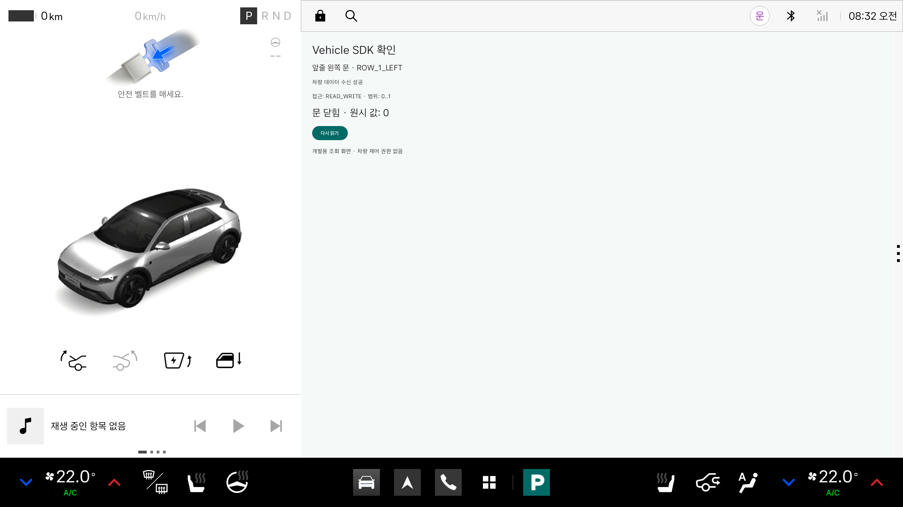

# Vehicle SDK 기본 검증

검증일: 2026-10-29 (한국 시간).
목표는 기본 앱 실행과 차량 데이터 한 항목의 실제 수신 여부를 확인하는 것입니다.

## 환경

| 항목 | 검증 환경 |
| --- | --- |
| 호스트 | macOS / Apple Silicon (arm64) |
| Android Studio | Rabbit 2 / 2026.2.2 |
| Android Emulator | 37.2.12, Hypervisor.Framework 하드웨어 가속 |
| 전용 이미지 | Pleos Connect 2.1.0 / Android 14 (API 34) / arm64-v8a |
| AVD | `Pleos_Connect_2_1`, RAM 4GB, Cold boot, 2560 × 1440 |
| Vehicle SDK / Service | 2.3.2 / 2.3.22 |
| 앱 | `io.github.univjh.pleosapp`, debug 빌드 |

호스트별 개발 명령은 [SETUP.md](SETUP.md)를 따릅니다.
이번 에뮬레이터 실행 검증은 macOS에서 수행했으며, Windows·Linux 실행 결과를 의미하지 않습니다.

## 구현 범위

- `src/debug`에만 `VehicleSmokeActivity`와 `CAR_DOORS` 조회 권한을 선언합니다.
- `Vehicle.initialize()` 호출 후 `checkDoorPositionCapabilities()`의 실제 응답을 기다립니다.
- 접근 수준이 `READ` 또는 `READ_WRITE`이고 `ROW_1_LEFT` 영역이 지원될 때 `getCurrentDoorPosition()`을 호출합니다.
- `0..1` 범위를 반환한 경우에만 `0`을 닫힘, `1`을 열림으로 표시합니다. 그 밖의 범위는 원시 값을 표시합니다.
- `null`을 닫힘으로 취급하지 않습니다. 오류와 10초 응답 시간 초과를 별도로 표시합니다.
- 화면이 멈추면 세션을 해제하고, 종료되거나 이전 요청에 해당하는 늦은 콜백은 무시합니다.
- 차량 제어 API와 상태 변경 Listener는 사용하지 않습니다. 현재 값은 진입 또는 **다시 읽기** 시에만 조회합니다.

`READ_WRITE`는 연결된 서비스의 기능 지원 범위입니다. 앱에 쓰기 권한을 부여했다는 의미가 아닙니다.
실제로 설치된 앱의 차량 관련 권한은 `CAR_DOORS`와 SDK의 `VEHICLE_BINDING`이며, `CONTROL_CAR_DOORS`는 없습니다.

## 재현 절차

1. Pleos 전용 AVD를 시작하고 부팅을 기다립니다.
2. 프로젝트를 빌드하여 debug APK를 설치합니다.

macOS / Linux:

```bash
./gradlew :app:assembleDebug :app:lintDebug :app:installDebug
```

Windows PowerShell:

```powershell
.\gradlew.bat :app:assembleDebug :app:lintDebug :app:installDebug
```

이하 명령은 모든 OS에서 같습니다. 여러 기기가 연결돼 있다면 `adb -s <serial>`을 사용합니다.

```bash
adb shell am start -W --activity-clear-top -n io.github.univjh.pleosapp/.MainActivity
adb shell am start -W --activity-clear-top -n io.github.univjh.pleosapp/.VehicleSmokeActivity
adb forward tcp:8088 tcp:8088
```

3. 기본 화면이 실행되고, 조회 화면에 지원 범위와 현재 값이 표시되는지 확인합니다.
4. PC 브라우저에서 <http://127.0.0.1:8088/>를 열고 **BODY → FL door**를 켭니다.
5. 앱의 **다시 읽기**를 누르거나 조회 화면을 종료 후 다시 열어 값 `1`을 확인합니다.
6. **FL door**를 끄고 다시 조회하여 원래 값 `0`으로 복원됐는지 확인합니다.

```bash
adb logcat -d -s PleosVehicleSmoke:I "*:S"
```

## 확인 결과

| 시나리오 | 실제 결과 |
| --- | --- |
| Android Studio 프로젝트 열기 | Gradle JDK를 Temurin 17로 지정 후 Sync 성공 |
| 전용 AVD 부팅 / ADB 연결 | Android 14, `sys.boot_completed=1`, ADB `device` |
| 기본 화면 실행 | `MainActivity` 실행 성공, Pleos 화면 안에 시작 문구 표시 |
| 문 지원 범위 조회 | `ROW_1_LEFT`, `READ_WRITE`, 범위 `0..1` |
| 최초 닫힌 상태 조회 | `position=0` |
| Virtual Console에서 FL door 열기 후 앱 재실행 | `position=1`, 화면에 문 열림 표시 |
| FL door 닫기 및 화면 재진입 | `position=0`, 화면에 문 닫힘 표시 |
| 화면을 떠날 때 정리 | `Vehicle session released` 로그 확인 |
| 로컬 빌드 / Lint | 통과, 오류 0건; 기존 버전 알림·백업 규칙 관련 경고 13건 |
| release Manifest | 조회 Activity와 `CAR_DOORS` 권한 미포함 확인 |

SDK의 초기화 반환뿐 아니라 capability와 get의 성공 콜백을 기준으로 검증했습니다.
핵심 로그는 다음과 같습니다. 순서대로 실제 서비스에서 수신한 값입니다.

```text
CAPABILITY area=ROW_1_LEFT access=READ_WRITE min=0 max=1
READ area=ROW_1_LEFT position=0
READ area=ROW_1_LEFT position=1
Vehicle session released
CAPABILITY area=ROW_1_LEFT access=READ_WRITE min=0 max=1
READ area=ROW_1_LEFT position=0
```

에뮬레이터의 초기 시각이 호스트와 달라 logcat 시각 대신 호스트 날짜를 검증일로 기록했습니다.
부팅 중 기본 입력기 `ai.umos.inputmethod`의 오류 로그가 있었지만, 이 앱의 실행과 조회는 정상 동작했습니다.

실행 화면:







이 검증은 실차, 다른 차량 도메인, NaviHelper, 상태 변경 구독, 주행 중 사용 적합성까지 보장하지 않습니다.
미지원 영역·null·오류·시간 초과의 표시 경로는 구현했으나 이번 정상 연결 환경에서 별도로 주입 검증하지 않았습니다.

## 공식 참고 자료

- [Pleos 전용 AVD 설치](https://document.pleos.ai/docs/connect/guide/getting-started/application-development/setup-connect-sdk-emulator)
- [Virtual Console](https://document.pleos.ai/docs/connect/guide/getting-started/application-development/use-vehicle-emulator)
- [Vehicle 도메인 초기화와 해제](https://document.pleos.ai/docs/pleos-only/connect-sdk-pleos/Vehicle/obtain-domain-object)
- [기능 지원 범위 확인](https://document.pleos.ai/docs/pleos-only/connect-sdk-pleos/Vehicle/check-capability)
- [공식 Door Position 샘플](https://github.com/Pleos-Playground/pleos-sample-vehicle-app)
